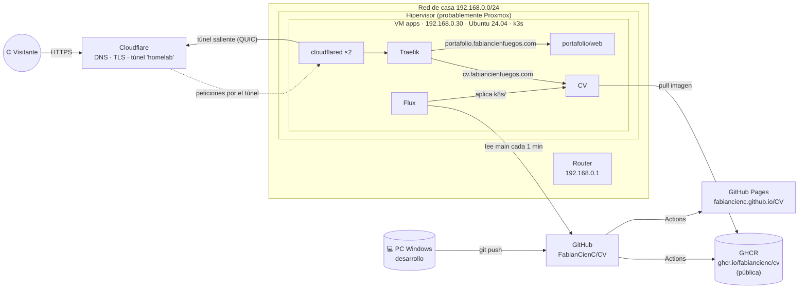
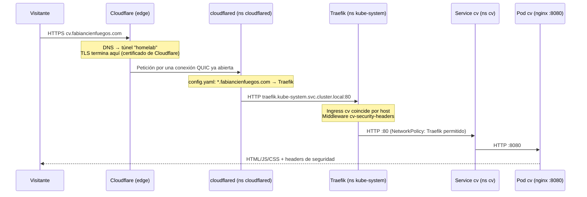
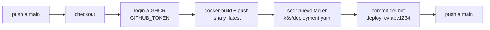
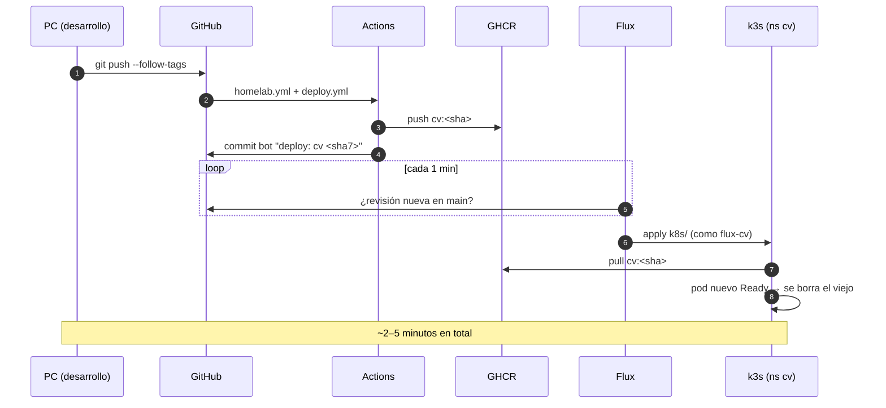

# Arquitectura del homelab de proyectos personales

Este documento describe el homelab completo: la máquina, el cluster k3s, cada namespace y qué corre en él, cómo llega el tráfico de internet a las aplicaciones y cómo un `git push` a este repositorio termina publicado en `https://cv.fabiancienfuegos.com`.

> **Fuente:** inventario tomado en el servidor `apps` el **2026-10-11**, con un script de solo lectura (§13), más la configuración de este repositorio. Lo que no se pudo comprobar está marcado como **⚠️ Por confirmar**. La lista completa está en §14.

---

## Índice

1. [Visión general](#1-visión-general)
2. [Infraestructura: la VM `apps`](#2-infraestructura-la-vm-apps)
3. [El cluster k3s](#3-el-cluster-k3s)
4. [Namespaces y cargas de trabajo](#4-namespaces-y-cargas-de-trabajo)
5. [Red: direcciones, puertos y exposición](#5-red-direcciones-puertos-y-exposición)
6. [Entrada desde internet: Cloudflare Tunnel + Traefik](#6-entrada-desde-internet-cloudflare-tunnel--traefik)
7. [App: CV (namespace `cv`)](#7-app-cv-namespace-cv)
8. [App: portafolio (namespace `portafolio`)](#8-app-portafolio-namespace-portafolio)
9. [Flux: GitOps](#9-flux-gitops)
10. [CI/CD con GitHub Actions y versionado](#10-cicd-con-github-actions-y-versionado)
11. [Seguridad: qué está protegido y qué no](#11-seguridad-qué-está-protegido-y-qué-no)
12. [Respaldo y recuperación](#12-respaldo-y-recuperación)
13. [Operación diaria y diagnóstico](#13-operación-diaria-y-diagnóstico)
14. [Pendientes y por confirmar](#14-pendientes-y-por-confirmar)

---

## 1. Visión general



**Principios de diseño:**

- **No hay puertos abiertos hacia internet.** `cloudflared` abre conexiones *salientes* a Cloudflare, y las visitas entran por ellas.
- **GitHub no tiene acceso al cluster.** El cluster (Flux) *lee* el repo público. GitHub Actions solo construye la imagen y actualiza un archivo del repo.
- **Para el CV, git es la fuente de verdad.** Lo que esté en `k8s/` en `main` es lo que corre en el namespace `cv`.
- **Todo corre en un solo nodo.** No hay alta disponibilidad: si la VM se apaga, se caen todas las apps.

---

## 2. Infraestructura: la VM `apps`

| Elemento | Valor |
|---|---|
| Tipo | Máquina virtual KVM/QEMU (`Standard PC i440FX + PIIX`, firmware SeaBIOS) |
| Hipervisor | ⚠️ Por confirmar. La MAC `BC:24:11:…` corresponde al rango de **Proxmox VE** |
| QEMU Guest Agent | Activo (`qemu-guest-agent.service`): el hipervisor puede consultar la VM y apagarla limpiamente |
| Sistema operativo | Ubuntu 24.04.5 LTS (Noble), kernel 6.8.0-142-generic, x86-64 |
| CPU | 2 vCPU |
| RAM | 2.9 GiB, **sin swap**. Uso medido: ~1.7 GiB (58%) |
| Disco | 40 GB virtual (`/dev/sda`): `/` ext4 de 38 GB (16% usado), `/boot` de 881 MB y `/boot/efi` de 105 MB |
| Hostname | `apps` |
| IP | `192.168.0.30/24`, configurada estática; gateway `192.168.0.1` |
| Usuario | `fabian` (UID 1000, con sudo) |
| Actualizaciones | `unattended-upgrades` activo: aplica solo los parches de seguridad de Ubuntu |
| Firewall del SO | `ufw` **inactivo** |
| Tareas programadas | Ninguna (`crontab` vacío para `fabian` y `root`) |
| Otros | Sin Docker ni Tailscale instalados |

### Carpetas en `/home/fabian`

| Ruta | Contenido |
|---|---|
| `~/homelab/flux-cv.yaml` | Conexión de Flux con el repo del CV (§9). Pertenece a root porque se creó con `sudo`. |
| `~/.kube/` | kubeconfig del usuario: copia del admin de k3s, contexto `default` |
| `~/.cloudflared/` | Archivos del CLI `cloudflared` usados para crear el túnel. ⚠️ Probablemente incluye `cert.pem` (ver §11) |
| `~/cloudflare/` | ⚠️ Por confirmar. Probablemente los manifiestos de cloudflared que se aplicaron a mano |
| `~/.kubescape/` | Resultados de un escaneo con kubescape |
| `~/test/` | ⚠️ Por confirmar. Pruebas |
| `~/inventario.sh`, `~/inventario-homelab.txt` | El script de inventario de §13 y su salida |

### Capacidad

Uso de memoria aproximado por componente:

| Componente | RAM |
|---|---|
| Flux (4 controladores) | ~115 Mi |
| kube-system (CoreDNS, Traefik, metrics-server, local-path) | ~60 Mi |
| cloudflared ×2 | ~31 Mi |
| CV + portafolio | ~6 Mi |
| k3s (proceso del servidor, fuera de los pods) | el resto, ~500–700 Mi |

Para un par de sitios estáticos sobra espacio. Pero con 2.9 GiB y sin swap, una app pesada (una base de datos, algo en Java o Node) podría provocar que el kernel mate procesos por falta de memoria. Antes de agregar apps grandes, conviene subir la RAM de la VM.

---

## 3. El cluster k3s

| Elemento | Valor |
|---|---|
| Versión | k3s **v1.36.5+k3s1** (Kubernetes 1.36.5) |
| Nodos | 1: `apps`, con rol `control-plane` (también ejecuta las cargas de trabajo) |
| Instalación | Script oficial de k3s como servicio systemd `k3s.service` |
| Flags del servidor | `server --secrets-encryption` (no existe `/etc/rancher/k3s/config.yaml`) |
| Cifrado de secrets | **Activado**: los Secrets se guardan cifrados en la base de datos de k3s |
| Base de datos | ⚠️ Por confirmar. En instalación de un solo nodo sin `--cluster-init`, k3s usa SQLite en `/var/lib/rancher/k3s/server/db/` |
| Runtime de contenedores | containerd 2.3.4 |
| Red (CNI) | Flannel VXLAN (interfaz `flannel.1`, puente `cni0`) |
| NetworkPolicies | Aplicadas por el controlador integrado de k3s (kube-router) |
| Ingress controller | Traefik 3.7.13, instalado por k3s mediante el chart `traefik-40.1.5`. Sin `HelmChartConfig`, así que usa la configuración por defecto |
| LoadBalancer | ServiceLB (klipper-lb) de k3s: publica Traefik en los puertos 80 y 443 de la IP del nodo |
| Almacenamiento | StorageClass `local-path` (por defecto). **No hay ningún PV ni PVC**: ninguna app guarda datos |
| Métricas | metrics-server (habilita `kubectl top`) |
| DNS interno | CoreDNS, en `10.43.0.10` (`kube-dns`) |
| kubeconfig | Un único contexto `default` (admin) |

### Rangos de red internos

| Rango | Uso |
|---|---|
| `10.42.0.0/16` | IPs de los pods. El nodo `apps` usa `10.42.0.0/24` (puente `cni0` = `10.42.0.1`) |
| `10.43.0.0/16` | IPs de los Services (ClusterIP). La API es `10.43.0.1` |

### CRDs instalados (tipos de recursos extra)

- **Traefik** (`traefik.io`): IngressRoute, Middleware, TLSOption, TLSStore, ServersTransport, TraefikService, etc. Hoy solo se usa `Middleware`.
- **Traefik Hub** (`hub.traefik.io`): los trae el chart, pero no se usan.
- **Gateway API** (`gateway.networking.k8s.io`): los trae Traefik, pero no se usan.
- **k3s** (`k3s.cattle.io`, `helm.cattle.io`): Addon, HelmChart, HelmChartConfig, ETCDSnapshotFile.
- **Flux** (`*.toolkit.fluxcd.io`): GitRepository, Kustomization, HelmRelease, OCIRepository, Bucket, Alert, Provider, Receiver, etc.

---

## 4. Namespaces y cargas de trabajo

| Namespace | Pod Security | Cargas de trabajo | Cómo se instaló | En git |
|---|---|---|---|---|
| `kube-system` | — | CoreDNS, Traefik, svclb-traefik, metrics-server, local-path-provisioner | k3s | No (lo gestiona k3s) |
| `kube-public`, `kube-node-lease` | — | — | k3s | — |
| `default` | — | Vacío (solo el Service `kubernetes`) | k3s | — |
| `cloudflared` | `enforce: restricted` | Deployment `cloudflared` (2 réplicas) | `kubectl apply` a mano | ❌ |
| `portafolio` | `enforce: restricted` | Deployment `web` (1 réplica) | `kubectl apply` a mano | ❌ |
| `flux-system` | `warn: restricted` | 4 controladores de Flux | `flux install` | ❌ (`flux-cv.yaml` solo existe en el servidor) |
| `cv` | `enforce: restricted` | Deployment `cv` (1 réplica) | **Flux**, desde `k8s/` de este repo | ✅ |

### Inventario de pods

| Namespace | Pod / Deployment | Imagen | Puerto | Requests → Limits |
|---|---|---|---|---|
| `kube-system` | `coredns` | `rancher/mirrored-coredns-coredns:1.14.7` | 53 | — |
| `kube-system` | `traefik` | `rancher/mirrored-library-traefik:3.7.13` | 8000/8443 → Service 80/443 | — |
| `kube-system` | `svclb-traefik` (DaemonSet) | `rancher/klipper-lb:v0.4.17` | hostPort 80, 443 | — |
| `kube-system` | `metrics-server` | `rancher/mirrored-metrics-server:v0.9.0` | 443 | — |
| `kube-system` | `local-path-provisioner` | `rancher/local-path-provisioner:v0.0.37` | — | — |
| `kube-system` | `helm-install-traefik`, `helm-install-traefik-crd` (Jobs) | `rancher/klipper-helm` | — | Ya completados: instalaron Traefik |
| `cloudflared` | `cloudflared` ×2 | `cloudflare/cloudflared:2026.8.1` | 2000 (métricas) | 20m/32Mi → 200m/128Mi |
| `portafolio` | `web` | `nginxinc/nginx-unprivileged:stable-alpine` | 8080 | 50m/64Mi → 250m/128Mi |
| `cv` | `cv` | `ghcr.io/fabiancienc/cv:<sha>` | 8080 | 20m/32Mi → 200m/128Mi |
| `flux-system` | `source-controller` | `ghcr.io/fluxcd/source-controller:v1.9.6` | 9090 | — |
| `flux-system` | `kustomize-controller` | `ghcr.io/fluxcd/kustomize-controller:v1.9.6` | — | — |
| `flux-system` | `helm-controller` | `ghcr.io/fluxcd/helm-controller:v1.6.5` | — | — |
| `flux-system` | `notification-controller` | `ghcr.io/fluxcd/notification-controller:v1.9.4` | 80 (webhooks) | — |

### Services

| Namespace | Service | Tipo | IP | Puertos |
|---|---|---|---|---|
| `default` | `kubernetes` | ClusterIP | 10.43.0.1 | 443 |
| `kube-system` | `kube-dns` | ClusterIP | 10.43.0.10 | 53/UDP, 53/TCP, 9153 |
| `kube-system` | `metrics-server` | ClusterIP | 10.43.43.124 | 443 |
| `kube-system` | `traefik` | **LoadBalancer** | 10.43.122.237, externa **192.168.0.30** | 80 (NodePort 32702), 443 (NodePort 32535) |
| `cv` | `cv` | ClusterIP | 10.43.210.152 | 80 → 8080 |
| `portafolio` | `web` | ClusterIP | 10.43.211.95 | 80 → 8080 |
| `flux-system` | `source-controller`, `notification-controller`, `webhook-receiver` | ClusterIP | — | 80 |

### Ingress

| Namespace | Ingress | Host | Backend | Middleware |
|---|---|---|---|---|
| `cv` | `cv` | `cv.fabiancienfuegos.com` | `cv:80` | `cv-security-headers` |
| `portafolio` | `web` | `portafolio.fabiancienfuegos.com` | `web:80` | `portafolio-security-headers` |

---

## 5. Red: direcciones, puertos y exposición

### Qué escucha la VM

| Puerto | Proceso | Escucha en | Alcanzable desde |
|---|---|---|---|
| 22 | sshd | todas las interfaces | Toda la red de casa |
| 6443 | k3s (API de Kubernetes) | todas las interfaces | Toda la red de casa (requiere certificado o token) |
| 10250 | k3s (kubelet) | todas las interfaces | Toda la red de casa (requiere autenticación) |
| 80, 443 | Traefik vía svclb (iptables, por eso no aparece en `ss`) | 192.168.0.30 | Toda la red de casa |
| 32702, 32535 | NodePorts de Traefik | todas | Toda la red de casa |
| 6444, 10248, 10249, 10256–10259, 10010 | Componentes internos de k3s y containerd | 127.0.0.1 | Solo la propia VM |
| 53 | systemd-resolved | 127.0.0.53/54 | Solo la propia VM |

**Desde internet no se puede acceder a nada**, siempre que el router no tenga redirecciones de puertos (⚠️ por confirmar). Pero cualquier dispositivo de la red de casa (teléfonos, invitados en el WiFi, un equipo IoT comprometido) puede llegar a SSH, a la API de Kubernetes y a Traefik directamente, sin pasar por Cloudflare. Ver recomendaciones en §11.

### Políticas de red dentro del cluster

| Namespace | NetworkPolicies | Efecto |
|---|---|---|
| `cv` | `default-deny-ingress`, `allow-from-traefik`, `default-deny-egress` | Solo Traefik puede entrar y el pod no puede salir a ningún lado |
| `flux-system` | `allow-egress`, `allow-scraping`, `allow-webhooks` (las crea Flux) | Los controladores pueden salir (necesitan GitHub y GHCR) y reciben webhooks y métricas |
| `portafolio` | **Ninguna** | Cualquier pod del cluster puede hablar con `web`, y `web` puede salir a cualquier lado |
| `cloudflared` | **Ninguna** | Abierto (necesita salir a Cloudflare y a Traefik) |
| `kube-system` | Ninguna | Por defecto en k3s |

---

## 6. Entrada desde internet: Cloudflare Tunnel + Traefik

### El túnel

| Elemento | Valor |
|---|---|
| Nombre del túnel | `homelab` |
| Tipo | **Gestionado localmente**: la configuración vive en un ConfigMap del cluster, no en el panel de Cloudflare |
| Credenciales | Secret `cloudflared/tunnel-credentials` (`credentials.json`), cifrado en reposo por k3s |
| Configuración | ConfigMap `cloudflared/cloudflared` → `config.yaml` |
| Réplicas | 2 pods. Cada uno abre 4 conexiones QUIC a Cloudflare (vistas en los centros de datos `qro01` Querétaro y `dfw08` Dallas) |
| Métricas y salud | `:2000/metrics` y `:2000/ready`, este último usado como livenessProbe |
| Autoactualización | Desactivada (`no-autoupdate: true`). La versión se cambia editando la imagen |

`config.yaml` del túnel:

```yaml
tunnel: homelab
credentials-file: /etc/cloudflared/creds/credentials.json
metrics: 0.0.0.0:2000
no-autoupdate: true
ingress:
  # Todo el tráfico va a Traefik; Traefik elige la app por el host del Ingress.
  - hostname: "*.fabiancienfuegos.com"
    service: http://traefik.kube-system.svc.cluster.local:80
  - hostname: fabiancienfuegos.com
    service: http://traefik.kube-system.svc.cluster.local:80
  - service: http_status:404
```

Esto significa que **cualquier subdominio** de `fabiancienfuegos.com` y el dominio raíz llegan a Traefik:

- Si existe un Ingress con ese `host`, Traefik lo sirve.
- Si no, Traefik responde 404. Hoy `fabiancienfuegos.com` (el dominio raíz) devuelve 404, porque ningún Ingress lo usa.
- **Crear un Ingress en el cluster equivale a publicarlo en internet**, siempre que exista el registro DNS (ver abajo).

⚠️ Por confirmar en el panel de Cloudflare:
- Qué registros DNS apuntan al túnel: un CNAME comodín `*` hacia `<id-del-túnel>.cfargotunnel.com`, o uno por subdominio (`cv`, `portafolio`).
- El modo SSL/TLS y si hay reglas de WAF, Access o caché.

### Seguridad del pod de cloudflared

Es el pod con la configuración más estricta del cluster: `runAsNonRoot` (UID 65532), `readOnlyRootFilesystem`, `drop ALL`, `allowPrivilegeEscalation: false`, seccomp `RuntimeDefault`, sin token de ServiceAccount, y con la configuración y las credenciales montadas en solo lectura.

Aviso en los logs, inofensivo: `failed to sufficiently increase receive buffer size`. QUIC quiere un buffer UDP más grande. Se puede subir en la VM con `sysctl -w net.core.rmem_max=7500000 net.core.wmem_max=7500000` (y guardarlo en `/etc/sysctl.d/`) para mejorar un poco el rendimiento del túnel.

### Recorrido de una petición



Entre cloudflared y Traefik el tráfico es HTTP plano, pero no sale de la VM. Por eso los Middlewares usan `forceSTSHeader: true`: sin eso, Traefik no enviaría HSTS por una conexión HTTP.

---

## 7. App: CV (namespace `cv`)

- **Código:** este repositorio (React 19 + Vite, TypeScript).
- **URL:** `https://cv.fabiancienfuegos.com` (copia alternativa en GitHub Pages).
- **Versión desplegada al hacer el inventario:** `v2.0.0`, imagen `cv:c445ff20…`, revisión de Flux `617efaa`.

### Manifiestos ([`k8s/`](../k8s))

| Archivo | Recurso | Qué hace |
|---|---|---|
| `kustomization.yaml` | Kustomization | Lista los recursos que aplica Flux. **No incluye `namespace.yaml`** (ver §9) |
| `namespace.yaml` | Namespace `cv` | Solo como referencia; el namespace real lo crea `flux-cv.yaml` |
| `deployment.yaml` | Deployment `cv` | 1 réplica. El bot de GitHub Actions actualiza el tag de la imagen |
| `service.yaml` | Service `cv` | ClusterIP, 80 → 8080 |
| `ingress.yaml` | Ingress `cv` | `cv.fabiancienfuegos.com` → `cv:80`, con el Middleware de seguridad |
| `middleware.yaml` | Middleware `security-headers` | HSTS (1 año), `X-Frame-Options: DENY`, `nosniff`, Referrer-Policy, Permissions-Policy y CSP |
| `networkpolicy.yaml` | 3 NetworkPolicies | Solo entra tráfico de Traefik y el pod no puede salir |

### La imagen ([`Dockerfile`](../Dockerfile))

1. **Etapa de build:** `node:24-alpine` ejecuta `npm ci` y `npm run build`, y genera `dist/`.
2. **Etapa final:** `nginxinc/nginx-unprivileged:stable-alpine` solo con `dist/` en `/usr/share/nginx/html`. nginx corre sin root en el puerto 8080. La imagen final no contiene Node, código fuente ni `node_modules`.

`.dockerignore` excluye `node_modules`, `dist`, `.git`, `.github`, `k8s` y los `*.md`. La imagen es **pública** en GHCR, así que el cluster la descarga sin credenciales.

### Medidas de seguridad del pod

| Medida | Qué evita |
|---|---|
| Pod Security `restricted` (label del namespace) | Que se cree cualquier pod privilegiado, con root o con hostPath |
| `runAsNonRoot` | Ejecutar como root |
| `allowPrivilegeEscalation: false` | Escalar privilegios (setuid) |
| `capabilities: drop: [ALL]` | Capacidades especiales del kernel |
| `seccompProfile: RuntimeDefault` | Syscalls peligrosas |
| `readOnlyRootFilesystem: true` + `emptyDir` de 16Mi en `/tmp` y `/var/cache/nginx` | Modificar archivos del contenedor |
| `automountServiceAccountToken: false` | Que el pod tenga credenciales de la API |
| Límites de 200m de CPU y 128Mi de RAM | Que el pod acapare recursos de la VM |
| NetworkPolicies de entrada | Que otros pods hablen directamente con el CV |
| NetworkPolicy `default-deny-egress` | Que un pod comprometido alcance la red de casa o internet |

El readinessProbe (`GET /:8080`) lo hace el kubelet desde el nodo, así que las NetworkPolicies no lo bloquean. Los eventos `Readiness probe failed … connection refused` que aparecen al arrancar un pod son normales: el probe corre antes de que nginx termine de iniciar. En cada actualización, el pod viejo sigue sirviendo hasta que el nuevo está listo.

---

## 8. App: portafolio (namespace `portafolio`)

| Elemento | Valor |
|---|---|
| URL | `https://portafolio.fabiancienfuegos.com` |
| Deployment | `web`, 1 réplica |
| Imagen | `nginxinc/nginx-unprivileged:stable-alpine`, **la imagen genérica, sin contenido propio** |
| Service | `web`, ClusterIP 80 → 8080 |
| Ingress | `web`, host `portafolio.fabiancienfuegos.com`, Middleware `portafolio-security-headers` |
| Seguridad del pod | `runAsNonRoot`, seccomp, `drop ALL`, sin escalada de privilegios, sin token de SA, límites de 250m/128Mi |
| Le falta frente al CV | `readOnlyRootFilesystem`, NetworkPolicies |
| Instalación | `kubectl apply` manual (tiene la anotación `last-applied-configuration`) |
| En git | ❌ |

Como no tiene volúmenes ni una imagen propia, **hoy esta URL muestra la página "Welcome to nginx!"**. Parece una prueba o un marcador de posición. ⚠️ Por confirmar qué se planea publicar ahí.

Para llevarla al mismo nivel que el CV: su propio repo con Dockerfile y carpeta `k8s/`, un GitRepository y una Kustomization de Flux con su propia ServiceAccount limitada (`flux-portafolio`), y las mismas NetworkPolicies.

---

## 9. Flux: GitOps

| Elemento | Valor |
|---|---|
| Versión | Flux v2.9.6 |
| Instalación | `flux install`, **sin bootstrap** (`flux check`: `bootstrapped: false`) |
| Controladores | `source-controller`, `kustomize-controller`, `helm-controller`, `notification-controller` (sin los de automatización de imágenes) |
| Credenciales de GitHub en el cluster | **Ninguna**: el repo es público y se lee por HTTPS |
| Definición | `~/homelab/flux-cv.yaml`, aplicado a mano |

### `~/homelab/flux-cv.yaml`

```yaml
apiVersion: v1
kind: Namespace
metadata:
  name: cv
  labels:
    pod-security.kubernetes.io/enforce: restricted
---
apiVersion: v1
kind: ServiceAccount
metadata: { name: flux-cv, namespace: flux-system }
---
# Role (no ClusterRole): permisos totales, pero SOLO dentro del namespace cv.
apiVersion: rbac.authorization.k8s.io/v1
kind: Role
metadata: { name: flux-cv, namespace: cv }
rules:
  - apiGroups: ["*"]
    resources: ["*"]
    verbs: ["*"]
---
apiVersion: rbac.authorization.k8s.io/v1
kind: RoleBinding
metadata: { name: flux-cv, namespace: cv }
roleRef: { apiGroup: rbac.authorization.k8s.io, kind: Role, name: flux-cv }
subjects:
  - { kind: ServiceAccount, name: flux-cv, namespace: flux-system }
---
apiVersion: source.toolkit.fluxcd.io/v1
kind: GitRepository
metadata: { name: cv, namespace: flux-system }
spec:
  interval: 1m
  url: https://github.com/FabianCienC/CV
  ref: { branch: main }
---
apiVersion: kustomize.toolkit.fluxcd.io/v1
kind: Kustomization
metadata: { name: cv, namespace: flux-system }
spec:
  interval: 5m
  sourceRef: { kind: GitRepository, name: cv }
  path: ./k8s
  prune: true
  targetNamespace: cv
  serviceAccountName: flux-cv
```

| Recurso | Función |
|---|---|
| `GitRepository cv` | Cada minuto descarga `main` y guarda la revisión como artefacto |
| `Kustomization cv` | Cuando cambia la revisión (o cada 5 min como respaldo), aplica `./k8s` en el namespace `cv`. Con `prune: true`, borra del cluster lo que se elimine del repo y revierte cambios manuales |
| `ServiceAccount flux-cv` | La identidad que Flux usa para aplicar. Vive en `flux-system` porque Flux la busca en el namespace de la Kustomization |
| `Role` + `RoleBinding flux-cv` | Todos los permisos, **solo dentro de `cv`** |

### Permisos: un detalle importante

Flux instala la ClusterRoleBinding `cluster-reconciler-flux-system`, que le da `cluster-admin` a `kustomize-controller` y `helm-controller`. La Kustomization `cv` **no usa esos permisos**: suplanta a `flux-cv`, que solo puede tocar `cv`.

Pero **cualquier Kustomization o HelmRelease que se cree sin `serviceAccountName` correrá como cluster-admin**. Regla para futuras apps: siempre una ServiceAccount propia, con un Role limitado a su namespace.

Por esa misma limitación, Flux no puede crear el namespace `cv` (crear namespaces requiere permisos sobre todo el cluster). Por eso el namespace se crea en `flux-cv.yaml` y `namespace.yaml` no está en `kustomization.yaml`.

### Clientes con permisos amplios en el cluster

| ClusterRoleBinding | Quién | Rol |
|---|---|---|
| `cluster-reconciler-flux-system` | `flux-system/kustomize-controller`, `flux-system/helm-controller` | `cluster-admin` |
| `helm-kube-system-traefik`, `helm-kube-system-traefik-crd` | Jobs de instalación de Traefik de k3s | `cluster-admin` |
| `traefik-kube-system` | `kube-system/traefik` | Leer Ingress, Services y CRDs de Traefik |
| `crd-controller-flux-system` | Controladores de Flux | Gestionar sus CRDs |
| `local-path-provisioner-bind`, `k3s-cloud-controller-manager` | Componentes de k3s | Específicos |
| kubeconfig de `fabian` (`~/.kube/config`) | Usuario | Admin total |

---

## 10. CI/CD con GitHub Actions y versionado

### Workflows ([`.github/workflows/`](../.github/workflows))

**`homelab.yml`: Build and deploy to homelab**



- **Cuándo corre:** con cada push a `main`, **salvo** que el push solo cambie archivos de `k8s/` (`paths-ignore`). Así el commit del bot no vuelve a lanzar el workflow. También se puede lanzar a mano (`workflow_dispatch`).
- **Permisos del token:** `contents: write` para hacer el commit y `packages: write` para subir la imagen.
- **Concurrencia:** el grupo `homelab` evita dos despliegues simultáneos.
- **Actions fijadas por SHA de commit,** con la versión en un comentario: checkout v7.0.1, login-action v3.7.0, setup-buildx-action v3.12.0 y build-push-action v6.19.2.
- **Tags de la imagen:** `:<sha-completo>`, que es el que usa el manifiesto, y `:latest`.

**`deploy.yml`: Deploy to GitHub Pages.** Hace lint y build con `--base=/CV/` y publica en `https://fabiancienc.github.io/CV/`. Es independiente del homelab.

### De `git push` a la página



### Versionado (SemVer)

- La versión está en `package.json`. [`vite.config.ts`](../vite.config.ts) la expone como `__APP_VERSION__` y el footer la muestra (`/ v2.0.0`).
- Cada versión se marca con un tag de git `vX.Y.Z`.

| Cambio | Comando |
|---|---|
| Corrección | `npm version patch` (2.0.0 → 2.0.1) |
| Contenido nuevo | `npm version minor` (2.0.0 → 2.1.0) |
| Rediseño | `npm version major` (2.0.0 → 3.0.0) |

```bash
git pull                      # traer el commit del bot
git add . && git commit -m "Describe el cambio"
npm version minor             # package.json + commit + tag
git push --follow-tags        # se despliega solo
```

El tag de git dice qué versión del código es; el tag de la imagen (`:sha`) dice exactamente qué build corre. Para saber qué versión está en producción:
`kubectl get deploy cv -n cv -o jsonpath='{.spec.template.spec.containers[0].image}'`, y comparar el SHA con `git log`.

---

## 11. Seguridad: qué está protegido y qué no

### Bien resuelto

| Amenaza | Mitigación |
|---|---|
| Escaneo de la IP pública de casa | No hay puertos abiertos: todo entra por el túnel saliente (si el router no tiene redirecciones, ⚠️ por confirmar) |
| Se filtran secretos de GitHub | GitHub no tiene credenciales del cluster. `GITHUB_TOKEN` es temporal y está limitado al repo y a GHCR |
| Una action de terceros se compromete | Fijadas por SHA |
| Alguien escribe en el repo del CV | Flux solo puede tocar `cv`, y Pod Security `restricted` impide pods privilegiados |
| Se explota una vulnerabilidad en nginx del CV | Sin root, sin capabilities, disco de solo lectura, sin token, sin salida de red, con límites de recursos |
| Alguien lee la base de datos de k3s | Secrets cifrados en reposo (`--secrets-encryption`) |
| Ataques del lado del navegador | Headers de seguridad (CSP, HSTS, X-Frame-Options, nosniff) en ambas apps |
| Parches del SO | `unattended-upgrades` activo |

### Riesgos actuales (de mayor a menor)

1. **La red de casa ve todos los servicios de la VM.** SSH (22), la API de Kubernetes (6443), el kubelet (10250) y Traefik (80/443) están abiertos para cualquier dispositivo de la LAN, y `ufw` está apagado. Recomendación: activar `ufw` permitiendo SSH solo desde tu PC, los rangos del cluster (`10.42.0.0/16`, `10.43.0.0/16`) y lo que necesite el hipervisor. Hay que hacerlo con cuidado para no cortar la red de k3s ni el acceso por SSH.
2. **`~/.cloudflared/cert.pem`** (⚠️ verificar que exista). Ese certificado permite crear, borrar y redirigir túneles y DNS de tu cuenta de Cloudflare. El túnel en marcha no lo necesita. Recomendación: guardarlo fuera del servidor (gestor de contraseñas) y borrarlo de la VM.
3. **Túnel con comodín.** Cualquier Ingress nuevo, con cualquier subdominio, queda público. Si un día pruebas algo interno con un Ingress, quedará expuesto sin querer. Recomendación: listar los hostnames explícitamente (`cv`, `portafolio`) en el `config.yaml`.
4. **`portafolio` y `cloudflared` sin NetworkPolicies.** Un pod comprometido en el cluster podría hablar con ellos, y ellos con la LAN.
5. **Infraestructura fuera de git.** `cloudflared`, `portafolio` y `flux-cv.yaml` existen solo en el cluster y en el servidor. Si se pierde la VM, hay que reconstruirlos de memoria (ver §12).
6. **Kustomizations futuras sin `serviceAccountName`** correrían como cluster-admin (ver §9).
7. **Cuenta de GitHub** (⚠️ por confirmar): 2FA y protección de rama en `main`. Quien controle la cuenta controla lo que se despliega.

### Mejoras pendientes

- [ ] `ufw` en la VM (riesgo 1)
- [ ] Sacar `cert.pem` del servidor (riesgo 2)
- [ ] Hostnames explícitos en el túnel (riesgo 3)
- [ ] NetworkPolicies y `readOnlyRootFilesystem` en `portafolio`; NetworkPolicy de salida en `cloudflared` (riesgo 4)
- [ ] Repo privado de infraestructura (`homelab-infra`) con los manifiestos de `cloudflared`, `portafolio` y `flux-cv.yaml` (riesgo 5)
- [ ] 2FA y protección de rama en GitHub (riesgo 7)
- [ ] Dependabot para las actions fijadas por SHA
- [ ] Desplegar por digest (`cv@sha256:…`) en lugar de por tag
- [ ] Subir los buffers UDP para QUIC (§6)

---

## 12. Respaldo y recuperación

**Hoy no hay ningún respaldo configurado**, pero tampoco hay datos persistentes (ningún PVC). Todo el estado del homelab se reconstruye con:

| Qué | Dónde está hoy | Cómo respaldarlo |
|---|---|---|
| Manifiestos del CV | Este repo (GitHub) | Ya respaldado |
| `flux-cv.yaml` | `~/homelab/` en la VM | Copia en un repo privado |
| Manifiestos de `cloudflared` (Deployment + ConfigMap) | Cluster (y probablemente `~/cloudflare/`) | `kubectl get deploy,cm -n cloudflared -o yaml` → repo privado |
| `credentials.json` del túnel | Secret `cloudflared/tunnel-credentials` | **Gestor de contraseñas**, nunca en git |
| `cert.pem` de Cloudflare | `~/.cloudflared/` | Gestor de contraseñas, y borrarlo de la VM |
| Manifiestos de `portafolio` | Solo en el cluster | `kubectl get deploy,svc,ingress,middleware -n portafolio -o yaml` → repo |
| La VM completa | Hipervisor | Snapshot o backup programado de la VM desde Proxmox (⚠️ por confirmar) |

### Reconstruir desde cero

```bash
# 1. VM Ubuntu 24.04 con IP 192.168.0.30
curl -sfL https://get.k3s.io | sh -s - server --secrets-encryption
mkdir -p ~/.kube && sudo cp /etc/rancher/k3s/k3s.yaml ~/.kube/config && sudo chown $USER ~/.kube/config

# 2. Túnel
kubectl create namespace cloudflared
kubectl label namespace cloudflared pod-security.kubernetes.io/enforce=restricted
kubectl create secret generic tunnel-credentials -n cloudflared --from-file=credentials.json=./credentials.json
kubectl apply -f cloudflared/            # Deployment + ConfigMap respaldados

# 3. Flux + CV
curl -s https://fluxcd.io/install.sh | sudo bash
flux install
kubectl apply -f flux-cv.yaml            # Flux despliega el CV solo

# 4. Portafolio
kubectl apply -f portafolio/
```

---

## 13. Operación diaria y diagnóstico

Ejecutar en la VM `apps`.

```bash
# Estado general
kubectl get pods -A
kubectl top nodes && kubectl top pods -A
kubectl get events -A --field-selector type=Warning

# Flux
flux get sources git
flux get kustomizations
flux logs --kind=Kustomization --name=cv
flux reconcile kustomization cv --with-source      # forzar sincronización
flux suspend kustomization cv                      # pausar despliegues automáticos
flux resume kustomization cv

# CV
kubectl get pods,svc,ingress,networkpolicy -n cv
kubectl describe pod -n cv -l app=cv
kubectl logs -n cv deploy/cv
kubectl port-forward -n cv svc/cv 8080:80          # probar sin Cloudflare ni Traefik

# Probar Traefik desde la LAN, sin pasar por Cloudflare
curl -H "Host: cv.fabiancienfuegos.com" http://192.168.0.30/

# Túnel
kubectl get pods -n cloudflared
kubectl logs -n cloudflared deploy/cloudflared --tail=50
kubectl get cm cloudflared -n cloudflared -o yaml  # ver las reglas del túnel

# Cambiar las reglas del túnel
kubectl edit cm cloudflared -n cloudflared
kubectl rollout restart deploy/cloudflared -n cloudflared

# k3s
sudo systemctl status k3s
sudo journalctl -u k3s --since "1 hour ago"
```

### Volver a una versión anterior del CV

```bash
git revert <commit-problemático> && git push       # Flux despliega la versión anterior
```
En una emergencia: `flux suspend kustomization cv` y luego `kubectl set image -n cv deploy/cv cv=ghcr.io/fabiancienc/cv:<sha-anterior>`. Después corregir en git y ejecutar `flux resume kustomization cv`.

### Problemas frecuentes

| Síntoma | Causa probable | Solución |
|---|---|---|
| `git push` rechazado (`fetch first`) | El bot subió su commit de despliegue | `git pull` y volver a hacer push |
| Run en rojo en el paso del tag | Dos push seguidos; `main` avanzó durante el run | No requiere acción: el siguiente run despliega lo último |
| Kustomization `Forbidden` | `flux-cv` no existe en `flux-system` o le falta el RoleBinding | Revisar `flux-cv.yaml` |
| `ImagePullBackOff` | El paquete de GHCR dejó de ser público o el tag no existe | GitHub → Packages → visibilidad |
| `CrashLoopBackOff` con error de escritura | nginx necesita escribir en una ruta sin `emptyDir` | Montarla en `deployment.yaml` |
| La web carga sin fuentes o imágenes | La CSP las bloquea | Consola del navegador → ajustar `middleware.yaml` |
| 404 en un subdominio | No hay Ingress con ese `host`, o no hay registro DNS | `kubectl get ingress -A` y el DNS en Cloudflare |
| Error 1033 de Cloudflare | Los pods de cloudflared no están conectados | `kubectl logs -n cloudflared deploy/cloudflared` |
| Pods `Pending` o `OOMKilled` | La VM se quedó sin memoria | `kubectl top`; subir la RAM de la VM |

### Script de inventario

`~/inventario.sh` regenera la información de este documento (solo lee, y tapa tokens y contraseñas) en `~/inventario-homelab.txt`. Conviene ejecutarlo de nuevo después de cambios grandes y actualizar este documento.

---

## 14. Pendientes y por confirmar

**Se puede comprobar en la VM:**
- [ ] `ls -la ~/.cloudflared ~/cloudflare ~/test`: ¿existe `cert.pem`? ¿Qué hay en `~/cloudflare`?
- [ ] `sudo ls /var/lib/rancher/k3s/server/db/`: ¿SQLite (`state.db`) o etcd?
- [ ] `sudo ls /var/lib/rancher/k3s/server/manifests`: manifiestos que k3s aplica automáticamente.

**Solo se sabe fuera del servidor:**
- [ ] Hipervisor: ¿Proxmox? ¿En qué hardware? ¿Hay otras VMs? ¿Se hacen snapshots o backups?
- [ ] Router: ¿modelo? ¿Hay redirecciones de puertos? ¿La IP `.30` está reservada por DHCP o es fija? ¿Hay una VLAN o red de invitados separada?
- [ ] Acceso remoto: ¿cómo se entra a la VM desde fuera de casa?
- [ ] Cloudflare: registros DNS (¿CNAME comodín?), modo SSL/TLS, WAF, Access, reglas de caché.
- [ ] Dominio `fabiancienfuegos.com`: registrador y fecha de vencimiento.
- [ ] GitHub: ¿2FA activo? ¿Protección de rama en `main`?
- [ ] Portafolio: ¿qué app se publicará ahí?
- [ ] Planes: ¿qué otras apps se agregarán?
